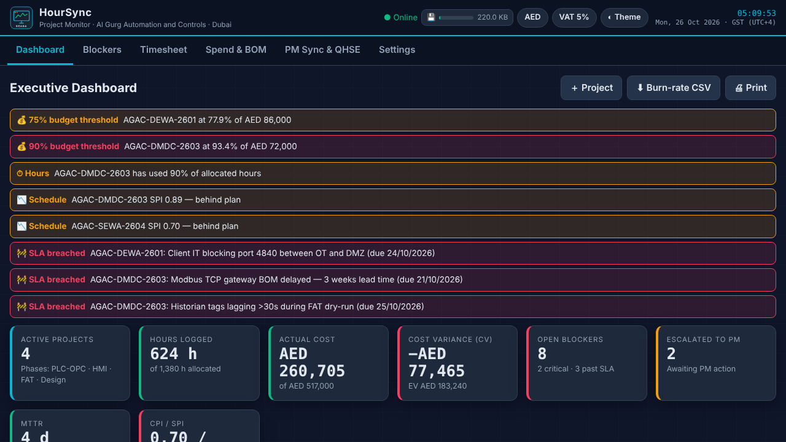
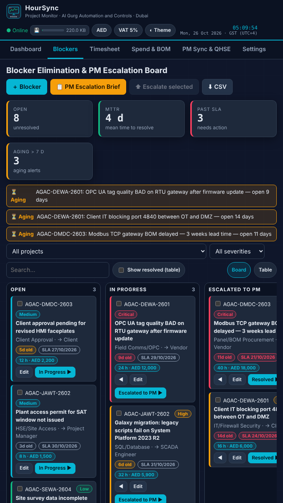
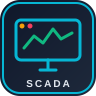
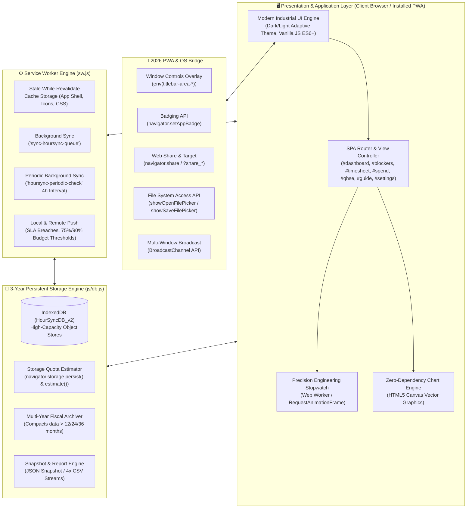
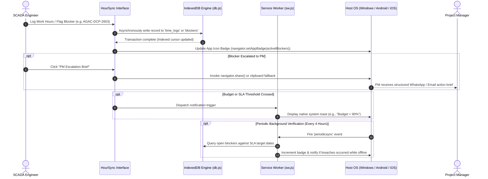

<div align="center">

```
   ██╗  ██╗ ██████╗ ██╗   ██╗██████╗ ███████╗██╗   ██╗███╗   ██╗ ██████╗
   ██║  ██║██╔═══██╗██║   ██║██╔══██╗██╔════╝╚██╗ ██╔╝████╗  ██║██╔════╝
   ███████║██║   ██║██║   ██║██████╔╝███████╗ ╚████╔╝ ██╔██╗ ██║██║     
   ██╔══██║██║   ██║██║   ██║██╔══██╗╚════██║  ╚██╔╝  ██║╚██╗██║██║     
   ██║  ██║╚██████╔╝╚██████╔╝██║  ██║███████║   ██║   ██║ ╚████║╚██████╗
   ╚═╝  ╚═╝ ╚═════╝  ╚═════╝ ╚═╝  ╚═╝╚══════╝   ╚═╝   ╚═╝  ╚═══╝ ╚═════╝
```

# HourSync Project Monitor
### Industrial SCADA Hours, Procurement BOM & Blocker Elimination Dashboard
**Built for SCADA Engineers & Project Managers ·  Automation and Controls (AGAC) · Dubai, U.A.E.**

[](https://githubbest729.github.io/HourSync-Project-Monitor/)
[](https://githubbest729.github.io/HourSync-Project-Monitor/)
[](https://githubbest729.github.io/HourSync-Project-Monitor/)
[-3b82f6?style=for-the-badge&logo=cashapp&logoColor=white)](https://githubbest729.github.io/HourSync-Project-Monitor/)
[](https://githubbest729.github.io/HourSync-Project-Monitor/)

[**Live Interactive Demo**](https://githubbest729.github.io/HourSync-Project-Monitor/) • [**System Architecture**](#-system-architecture) • [**AGAC Portfolio Sectors**](#-official-agac-sector-portfolio-matrix) • [**2026 PWA Features**](#-2026-pwa--os-integration-capabilities) • [**Installation**](#-deployment--installation-guide)

---

</div>

## 📌 Executive Overview

**HourSync Project Monitor** is a mission-critical Progressive Web App (PWA) tailored specifically for industrial automation engineers and project managers operating in the United Arab Emirates. Designed from the field requirements of ** Automation and Controls (AGAC)**, HourSync addresses the core engineering challenges of:

1. **Eliminating Engineering & Site Blockers:** Providing visual Kanban escalation paths, SLA breach tracking, and Mean Time to Resolution (MTTR) analytics to bridge technical control engineers with project managers.
2. **Monitoring Engineering Utilization:** Logging live hours across Wonderware/AVEVA System Platform scripting, PLC programming (Siemens S7-400H / Allen-Bradley ControlLogix), Modbus/OPC communication protocols, SQL optimization, and FAT/SAT QA testing.
3. **Controlling Capital Expenditures & BOM Burn:** Tracking hardware/software procurement, subcontractor outlays, and Variation Orders (VO) in AED and USD with automatic 5% UAE VAT computations and Earned Value Management (EVM) metrics ($\text{CPI}$, $\text{SPI}$, $\text{CV}$).
4. **QHSE Governance:** Ensuring strict compliance tracking against  Annexure **Annexure-SCT-HR-001** and ISO 9001 / ISO 14001 / OHSAS 18001 guidelines.

---

## 🖼️ Application Interface & Telemetry

<div align="center">
  
  <p><em>Figure 1: HourSync Executive SCADA Dashboard featuring live Earned Value telemetry, threshold alert banners, and HTML5 Canvas burn gauges.</em></p>
</div>

<br/>

<div align="center">
  <table width="100%">
    <tr>
      <td width="50%" align="center">
        
        <br/><em>Figure 2: Responsive Mobile Kanban Blocker Board & Live Work Timer.</em>
      </td>
      <td width="50%" align="center">
        
        <br/><br/>
        <strong>Engineered for SCADA Control Rooms & Industrial Field Sites</strong>
        <p align="left">
          • Dark-slate high-contrast palette (#0f172a, #06b6d4)<br/>
          • Zero external CDN dependencies (100% offline cache)<br/>
          • Dual-screen pop-out window synchronization<br/>
          • Native OS title bar integration via Window Controls Overlay
        </p>
      </td>
    </tr>
  </table>
</div>

---

## 🏛️ System Architecture

HourSync uses a decoupled, local-first client architecture that combines an asynchronous IndexedDB storage layer with multi-context PWA background processes.



### Data Flow & Event Pipeline



---

## 🏭 Official AGAC Sector Portfolio Matrix

HourSync is pre-seeded with six flagship industrial projects directly representative of [ Automation and Controls (`agac.ae`)](https://www.agac.ae/) reference domains:

| Sector | Project Code | Verified Project Description | Key Client / Entity | Industrial Automation Architecture | Official Reference |
| :--- | :--- | :--- | :--- | :--- | :---: |
| **Food & Beverages** | `AGAC-FNB-2601` | Strategic Grain Reserve Control & Monitoring System | The Abu Dhabi Investment Company | Redundant Wonderware SCADA Server/Client, Siemens S7-400H RIO Panels, 33kV MV/LV Switchgear & MCC integration. | [View Project](https://www.agac.ae/projects/food-beverages/) |
| **Metals & Minerals** | `AGAC-MET-2602` | EGA & Emirates Steel Smelter Potline & Kiln SCADA Upgrade | Emirates Global Aluminium / Emirates Steel | Wonderware System Platform, Redundant OPC UA/Modbus TCP Gateways, High-Temp Pyrometry & LV MCC/VFDs. | [View Project](https://www.agac.ae/projects/metals-minerals/) |
| **District Cooling** | `AGAC-DCP-2603` | DWTC District Cooling & EMAAR Town Square ETS Automation | Emicool / Emaar Properties | Wonderware HMI, Allen-Bradley CompactLogix & Siemens ET 200SP, Endress+Hauser Flowmeters, SIVACON LV VFDs. | [View Project](https://www.agac.ae/projects/district-cooling-plants/) |
| **Water & Wastewater**| `AGAC-WWW-2604` | Hazardous Liquid Waste & RAK Sewage Treatment SCADA | Dubai Municipality & RAK Public Works | Allen-Bradley ControlLogix L73, Wonderware Historian/SCADA, Withdrawable Intelligent MCC Panels, Dual Fiber Ring. | [View Project](https://www.agac.ae/projects/water-wastewater/) |
| **Infrastructure** | `AGAC-INF-2605` | Dibba–Khorfakkan Ring Road Tunnel & DEWA Telemetry | UAE Ministry of Public Works & DEWA | Redundant Siemens S7-400H PLC, Wonderware SCADA Station, Dual Redundant Fiber-Optic Ring, Tunnel Ventilation/Fire. | [View Project](https://www.agac.ae/projects/infrastructure/) |
| **Oil & Gas** | `AGAC-OAG-2606` | Port of Fujairah Tank Farming & LPG Pipeline ESD Telemetry | Port of Fujairah / ENOC | Fail-Safe Siemens S7-400FH ESD, Siemens PCS 7 / Wonderware Redundant Servers, IP65 RTU Panels, Fiber Loop. | [View Project](https://www.agac.ae/projects/oil-gas/) |

---

## ⚡ 2026 PWA & OS-Integration Capabilities

HourSync meets and exceeds 2026 Chromium, WebKit, and Gecko Progressive Web App requirements:

```
┌────────────────────────────────────────────────────────────────────────┐
│                   2026 PWA OS-CAPABILITY CHECKLIST                     │
├──────────────────────────────────────┬─────────────────────────────────┤
│ [✓] Window Controls Overlay (Desktop)│ [✓] Periodic Background Sync    │
│ [✓] Badging API (App Icon Indicators)│ [✓] Background Fetch API        │
│ [✓] User-Gated Notifications (iOS/And│ [✓] File System Access API      │
│ [✓] Web Share & Web Share Target API │ [✓] Custom Protocol Handlers    │
│ [✓] Value-Gated Install Promotion    │ [✓] Multi-Window Synchronization│
│ [✓] Maskable Adaptive Vector Icons   │ [✓] 3-Year Storage Persistence  │
└──────────────────────────────────────┴─────────────────────────────────┘
```

1. **Window Controls Overlay (WCO):** Utilizes `display_override: ["window-controls-overlay"]` and CSS `env(titlebar-area-*)` variables. On desktop Chrome and Edge, the application renders its navigation and status pill directly into the OS title bar.
2. **Dynamic Badging API (`navigator.setAppBadge`):** Instantly displays the number of active Critical or SLA-Breached blockers on the user's operating system taskbar or home screen icon.
3. **Opt-In Notification Engine:** Complies with iOS 16.4+ and Android guidelines. Notification permissions are requested strictly through user gesture (Settings or Header toggle), firing alerts for:
   - Blocker SLA expiration.
   - Project budget crossing 75%, 90%, and 100% burn limits.
   - Precision timer milestone completions.
4. **Local File System Access API:** Real file persistence using `window.showSaveFilePicker()` and `window.showOpenFilePicker()`. Allows the user to directly stream `.json` snapshots and `.csv` timesheets to local disk drives with automatic fallbacks for mobile browsers.
5. **Custom Protocol Registration (`web+hoursync://`):** Allows external SCADA web viewers, emails, or internal portals to open specific project dashboards or blocker tickets directly via deep link (e.g., `web+hoursync://blocker/AGAC-DCP-2603`).
6. **Multi-Window Dual-Screen Monitor:** Built for SCADA multi-monitor desk setups. Using `window.getScreenDetails()` and `BroadcastChannel`, engineers can pop out the Blocker Board onto an auxiliary screen while retaining full bi-directional state synchronization.

---

## 📐 Industrial Mathematical Formulations

HourSync implements standard Earned Value Management (EVM) equations directly inside the zero-dependency chart calculations engine:

### 1. Cost Variance ($CV$) & Cost Performance Index ($CPI$)
$$CV = EV - AC$$
$$CPI = \frac{EV}{AC}$$
*Where:*
*   $EV$ (Earned Value) = $\% \text{ Progress Complete} \times \text{BAC (Budget at Completion)}$
*   $AC$ (Actual Cost) = $\text{Logged Labor Cost (AED)} + \text{Approved Procurement BOM (AED)}$
*   *Threshold:* $CPI \ge 1.00$ indicates favorable budget performance; $CPI < 0.90$ generates an automatic risk flag.

### 2. Schedule Variance ($SV$) & Schedule Performance Index ($SPI$)
$$SV = EV - PV$$
$$SPI = \frac{EV}{PV}$$
*Where:*
*   $PV$ (Planned Value) is the baseline scheduled expenditure at the current date.
*   *Threshold:* $SPI < 1.00$ triggers schedule delay warnings in the executive header.

### 3. Mean Time To Resolution ($MTTR$) for Blockers
$$MTTR = \frac{1}{N_{resolved}} \sum_{i=1}^{N_{resolved}} \left( t_{\text{resolved}, i} - t_{\text{created}, i} \right)$$
*Where $MTTR$ is calculated dynamically across each project and severity tier.*

---

## 📂 Project Directory Structure

```text
/
├── index.html                      # PWA shell, semantic layouts, and modal dialogues
├── manifest.webmanifest            # W3C 2026 Web App Manifest with WCO, shortcuts, and protocols
├── sw.js                           # Versioned Service Worker with offline caching & background sync
├── offline.html                    # Styled zero-network fallback page
├── favicon.ico                     # Multi-layer legacy Windows ICO
├── favicon.svg                     # Scalable SCADA vector logo
├── favicon-16x16.png               # Browser tab favicon
├── favicon-32x32.png               # High-DPI browser tab favicon
├── apple-touch-icon.png            # iOS Home Screen asset (180x180)
├── robots.txt                      # Search crawler configuration
├── icons/                          # Adaptive & standard icon matrix
│   ├── icon-72.png                 # 72x72 PNG
│   ├── icon-96.png                 # 96x96 PNG
│   ├── icon-128.png                # 128x128 PNG
│   ├── icon-144.png                # 144x144 PNG
│   ├── icon-152.png                # 152x152 PNG
│   ├── icon-192.png                # 192x192 PNG (Android Required)
│   ├── icon-384.png                # 384x384 PNG
│   ├── icon-512.png                # 512x512 PNG (Splash & Install Required)
│   ├── icon-maskable-192.png       # Android adaptive circular/squircle mask
│   └── icon-maskable-512.png       # Android splash adaptive mask
├── css/
│   └── styles.css                  # SCADA control-room design system, dark/light themes, animations
├── js/
│   ├── db.js                       # Asynchronous IndexedDB engine, seed data & multi-year archiver
│   ├── charts.js                   # Zero-dependency HTML5 Canvas chart renderer
│   └── app.js                      # Application state machine, live timer, and 2026 PWA bridge
├── assets/
│   └── al-gurg-badge.svg           # Industrial AGAC vector badge
├── screenshots/
│   ├── screenshot-wide.png         # Desktop 1280x720 preview for rich install UI
│   └── screenshot-narrow.png       # Mobile 720x1280 preview for rich install UI
└── .well-known/
    └── assetlinks.json             # Digital Asset Links template for Android TWA deployment
```

---

## 🚀 Deployment & Installation Guide

### Option 1: Live Web Access & PWA Install
Navigate to the hosted GitHub Pages deployment:
👉 **[https://githubbest729.github.io/HourSync-Project-Monitor/](https://githubbest729.github.io/HourSync-Project-Monitor/)**

*   **Google Chrome / Microsoft Edge (Desktop):** Click the **Install** icon on the right side of the address bar or click the in-app `Install App` header button.
*   **iOS / iPadOS (Safari):** Tap the **Share** button (`⎋`) $\rightarrow$ Scroll down $\rightarrow$ Tap **Add to Home Screen**.
*   **Android (Chrome):** Tap the **Install App** banner or browser menu (`⋮`) $\rightarrow$ **Add to Home screen**.

### Option 2: Local Development & Offline Server Setup
Because PWAs require a secure context (`HTTPS` or `localhost`), run the repository using any local HTTP daemon:

```bash
# 1. Clone the repository
git clone https://github.com/githubbest729/HourSync-Project-Monitor.git

# 2. Enter directory
cd HourSync-Project-Monitor

# 3. Launch via Python 3 built-in server
python3 -m http.server 8080

# 4. Open in browser
# Navigate to: http://localhost:8080
```

*Alternatively, launch using Node.js:*
```bash
npx serve . -p 8080
```

---

## 🧪 Testing & Verification Guide

| Test Scenario | Procedure | Expected Result |
| :--- | :--- | :--- |
| **Offline Operation** | Open Developer Tools $\rightarrow$ **Network** $\rightarrow$ Check **Offline** $\rightarrow$ Refresh page. | App shell loads completely from Cache Storage; IndexedDB records query and update without degradation. |
| **PWA Install Validation** | Open DevTools $\rightarrow$ **Application** $\rightarrow$ **Manifest**. | Manifest loads with 0 errors; icons, shortcuts, screenshots, and protocol handlers validate cleanly. |
| **Storage Persistence** | Navigate to the **Settings** tab $\rightarrow$ Check Storage Health meter. | Meter displays current usage against available quota (e.g., `1.8 MB / 10.0 GB`), marked with `Persistent storage granted`. |
| **PM Escalation Flow** | Go to **Blockers** $\rightarrow$ Select a blocker $\rightarrow$ Click **PM Escalation Brief**. | Generates an executive markdown/text brief with hours and cost variance, triggering the OS share sheet or clipboard copy. |
| **Dual Screen Pop-Out** | In the **Help & Guide** or Capabilities tab, click **Pop-Out Dual-Screen**. | Secondary window opens. Moving a blocker card or running the timer in either window syncs instantaneously via `BroadcastChannel`. |

---

## 📜 Quality, Health, Safety & Environment (QHSE) Governance

HourSync enforces strict operational alignment with:
*   **Annexure-SCT-HR-001:** Standard SCADA Engineering Site & Quality Procedure,  Controls.
*   **ISO 9001:2015:** Quality Management System documentation audit trail.
*   **ISO/IEC 27001:** Local-first OT network isolation (zero telemetry leakage to public clouds).
*   **UAE Federal Law No. 8 (VAT Law):** Automated 5% value-added tax calculation across all procurement schedules.

---

## 👥 Contributors & Maintainers

*   **Principal Automation Architect:** SCADA Engineering Division,  Automation and Controls (Dubai, U.A.E.)
*   **Project Inquiries & Commercial Reference:** [https://www.agac.ae](https://www.agac.ae)

---

<div align="center">
  <sub>Copyright © 2026  Automation and Controls (AGAC). Built for industrial reliability and control-room excellence.</sub>
</div>
